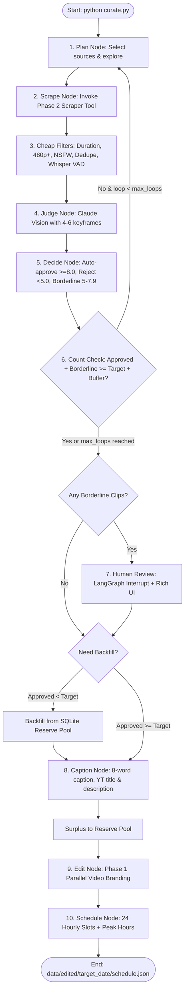

# 🧠 Automated Video Curation Agent (Phase 3)

A state-of-the-art autonomous video curation engine powered by **LangGraph**, **Anthropic Claude Vision**, **faster-whisper**, and **Pillow/FFmpeg**.

The agent inspects scraped videos from Phase 2, filters out noise and unsafe content, performs multimodal visual & comedic evaluation with Claude Vision, gathers human approval on borderline clips using interactive CLI checkpointing, generates viral punchy captions (max 8 words), brands approved videos using the Phase 1 editor, and schedules 24 hourly publishing slots for tomorrow.

---

## 🗺️ LangGraph Workflow Architecture



---

## ⚡ Key Capabilities

1. **Autonomous Re-planning Loops**:
   - Loop 1 begins with battle-tested baseline subreddits and X accounts.
   - Loop 2+ analyzes aggregated rejection reasons (e.g. "too many competitor watermarks") and pivots to fresh, untried sources.
2. **Zero-Cost Pre-Filtering & Audio VAD**:
   - Duration (5–60s), minimum 480p resolution, NSFW flags, and keyword blocklist.
   - **faster-whisper**: Evaluates audio with Voice Activity Detection (VAD). Clips with **no speech** are recognized as universal visual comedy and marked `language-free` (allowed).
3. **Claude Vision Multimodal Judging**:
   - Samples 4–6 evenly spaced keyframes across duration, downscaled to 480px.
   - Returns structured JSON: `funny_score` (1–10), `is_english_or_no_speech`, `is_safe_for_ads`, `has_visible_watermark`, and `reason`.
   - **SQLite Caching**: Cached by video file hash so identical clips are never judged twice.
4. **Interactive Human Review with SQLite Checkpointing**:
   - Scores 5.0 to 7.9 are routed to human review.
   - Uses `langgraph.types.interrupt` to pause execution. State is saved into `data/checkpoints.db`.
   - Interactive Rich terminal UI lets you `[A]pprove`, `[R]eject`, or `[E]dit caption`.
   - Resume anytime via `python curate.py --resume`.
5. **Reserve Pool & Surplus Preservation**:
   - If approved clips fall short of 24, automatically backfills from leftover approved clips from earlier days (`reserve_pool` table).
   - Any surplus approved clips beyond 24 are saved into the reserve pool for future days.
6. **Peak-Hour Optimization & Timezone Design**:
   - Scheduling is in ET (US audience). The dashboard displays IST.
   - High-engagement peak hours (12 PM, 2 PM, 5 PM, 7 PM, 8 PM, 9 PM ET) in `agent/config.yaml` (`timezone: "America/New_York"`) automatically receive the highest-scoring viral clips for US viewership.
   - The web dashboard presents all times in `Asia/Kolkata` (IST) with secondary US ET hints (e.g. `10:30 PM IST (12 PM ET)`), converting accurately across US Daylight Saving Time (EDT vs EST).
   - Sources are interleaved so identical subreddits are never posted back-to-back.

---

## 📁 Directory Structure

```
agent/
├── curate.py                   # Main CLI entry point (run, --resume, --dry-run)
├── config.yaml                 # Core configuration: thresholds, peak hours, models
├── config/
│   └── judge_examples.yaml     # Few-shot examples injected into Claude Vision
├── graph/
│   ├── state.py                # Typed CurationState schema
│   ├── build_graph.py          # StateGraph assembly, conditional routing & checkpointer
│   └── nodes/
│       ├── plan.py             # Strategic source planning
│       ├── scrape.py           # Phase 2 scraper wrapper
│       ├── filters.py          # Zero-cost duration/resolution/whisper filters
│       ├── judge.py            # Vision sampling & Claude evaluation
│       ├── decide.py           # Scoring & routing logic
│       ├── review.py           # Rich human review UI & LangGraph interrupt
│       ├── caption.py          # 8-word caption & YouTube description generation
│       ├── edit.py             # Phase 1 video editor invocation
│       └── schedule.py         # 24-slot allocation & schedule.json output
├── llm/
│   ├── client.py               # Anthropic Claude wrapper, token/cost tracker, mock mode
│   ├── prompts.py              # Centralized prompt templates
│   └── schemas.py              # Pydantic schemas (JudgeResult, CaptionResult, PlanResult)
├── tools/
│   ├── scraper_tool.py         # Phase 2 scraper integration
│   └── editor_tool.py          # Phase 1 video editor integration
├── core/
│   ├── db.py                   # SQLite tables (llm_cache, decisions, reserve_pool, schedule)
│   ├── frames.py               # OpenCV keyframe extraction and downscaling
│   ├── cost.py                 # Budget tracker & hard caps
│   └── review_ui.py            # Rich terminal review interface
├── tests/
│   ├── test_decide.py          # Scoring and routing unit tests
│   ├── test_captions.py        # Caption constraints & YouTube metadata tests
│   └── test_schedule.py        # Peak hours & slot distribution tests
└── README.md
```

---

## 🚀 Setup & Installation

### 1. Install Dependencies
```bash
pip install langgraph langgraph-checkpoint-sqlite anthropic rich faster-whisper opencv-python-headless pydantic pyyaml
```

### 2. Configure Credentials in `.env`
Create or edit `.env` in the project root:
```env
ANTHROPIC_API_KEY=sk-ant-api03-...
```
*(Note: If no API key is provided, or when running with `--dry-run`, the agent automatically runs in free Mock LLM mode with zero API cost!)*

---

## 🛠️ Usage Commands

### 1. Standard Production Curation for Tomorrow
```bash
python curate.py --target 24 --date tomorrow
```

### 2. Dry-Run Simulation (Zero Cost, No Edits)
Tests discovery, filtering, judging, captioning, and scheduling without rendering files or calling paid APIs:
```bash
python curate.py --target 24 --date tomorrow --dry-run
```

### 3. Resume Paused Human Review
If you paused human review or closed your terminal, resume right where you left off:
```bash
python curate.py --resume
```

### 4. Custom Date or Explicit Target
```bash
python curate.py --target 12 --date 2026-11-15 --workers 3
```

---

## 📦 Output Format: `schedule.json`

At the end of execution, `agent/data/edited/<target_date>/schedule.json` is generated for Phase 4 (YouTube Uploader):

```json
{
  "target_date": "2026-11-12",
  "timezone": "Asia/Kolkata",
  "created_at": "2026-11-11T01:25:00+05:30",
  "total_slots": 24,
  "empty_slots": [],
  "slots": [
    {
      "slot_hour": 12,
      "slot_time": "2026-11-12T12:00:00+05:30",
      "post_id": "reddit_sample_vid_001",
      "video_path": "C:\\...\\data\\edited\\2026-11-12\\reddit_sample_vid_001_branded.mp4",
      "title": "He thought he was smooth 😂 #shorts #funny",
      "description": "Credit to original creator: smooth_bro\nSource: https://reddit.com/r/funny/...\n\nSubscribe for daily laughs!",
      "caption": "He thought he was smooth 😂",
      "source_url": "https://reddit.com/r/funny/comments/sample_vid_001",
      "uploader": "smooth_bro",
      "score": 8.9,
      "is_peak": true,
      "status": "queued"
    }
  ]
}
```

---

## 📝 Prompts Documentation & Improvement Tips

All prompts are centralized in [`agent/llm/prompts.py`](file:///C:/Drive-D/python%20tut/100B/agent/llm/prompts.py).

### 1. Judge Prompt (`build_judge_system_prompt`)
- **What it does**: Directs Claude Vision to inspect 4–6 sequential keyframes, evaluate physical comedic timing, verify ad suitability, detect competitor watermarks, and return structured JSON (`funny_score`, `is_safe_for_ads`, `has_visible_watermark`, `reason`).
- **How to improve it**:
  - **Expand Few-Shot Examples**: Customize [`agent/config/judge_examples.yaml`](file:///C:/Drive-D/python%20tut/100B/agent/config/judge_examples.yaml) with 10 real viral hits and 10 misses from your niche. Few-shot visual descriptions improve scoring calibration significantly more than prompt wording changes.
  - **Calibrate Tone Thresholds**: Adjust `auto_approve_threshold` (default 8.0) and `auto_reject_threshold` (default 5.0) in `config.yaml` after running `--dry-run` for 2–3 days.

### 2. Caption Prompt (`build_caption_system_prompt`)
- **What it does**: Enforces YouTube Shorts best practices: strict $\le 8$ word cap, conversational phrasing, at most 1 emoji, zero hashtags in caption overlay, and generates a formatted YouTube title and description with creator attribution.
- **How to improve it**:
  - Add specific channel comedic personas (e.g. "dry sarcasm", "excited bewildered spectator", or "wholesome commentator").
  - Fine-tune hashtag selection in the YouTube title template for your target audience.

### 3. Plan Prompt (`build_plan_system_prompt`)
- **What it does**: Analyzes rejection reasons from earlier loops (e.g. low resolution, watermarks) and pivots discovery to fresh, high-yield sources from `allowed_sources`.
- **How to improve it**:
  - Expand `allowed_sources.subreddits` in `config.yaml` to include emerging niche comedy communities (e.g. `r/Catculations`, `r/ChildrenFallingOver`, `r/dadjokes`).

