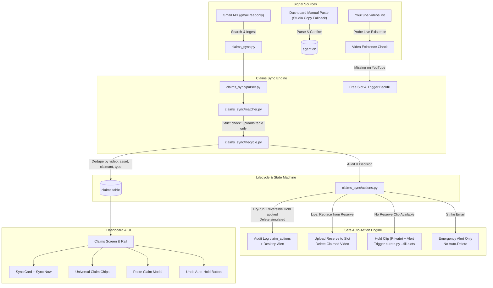

# Phase 6.1 — Claims Sync (Gmail), Claim Lifecycle, and Automatic Action Plan

> **Scope**: Read-only Gmail Content ID claim ingestion, claim lifecycle state machine, YouTube Studio paste fallback, safe auto-action engine (dry-run gated, reserve replacement, missing video sync), and dashboard sync controls.

---

## 1. Problem & Architecture Overview

### Problems Solved
1. **Unrecognized Claims on YouTube**:
   - *Example*: Post `reddit_1xw42j0` (*"Delivery Driver Finds Secret Cheat Code For Dogs"*, video `HcwZS5Sxv_Y`, scheduled for Nov 18, 12 PM ET) has a Content ID audio claim in YouTube Studio for *"Fortunate Son"* by Creedence Clearwater Revival ("Copyright Audio, no impact on reach, not a strike").
   - The YouTube Data API does not expose Content ID claims for regular channels. The dashboard currently displays *"Needs Check"* / *"Cleared"*.
2. **Outdated Claims in Dashboard & Deleted Video Sync**:
   - *Example*: Video `xwJJMYnUgSY` (`reddit_1xv7kmf`, car video) shows *"Claimed (kept)"* in the dashboard, but YouTube Studio no longer shows an active claim.
   - *Example*: Video `HcwZS5Sxv_Y` (`reddit_1xw42j0`) was deleted on YouTube, but our database still showed it as scheduled. Each sync must verify live video existence via `videos.list`.
3. **Automated Protection & Reserve Continuity**:
   - Block or delete claimed clips automatically before or after broadcast, replacing scheduled claimed clips from the rights-verified reserve pool without disrupting publication schedules.

### Boundary Constraints
- **Strict Prohibition**: Never scrape YouTube Studio or automate browsers against it (violates YouTube Terms of Service and risks channel termination).
- **Compliant Signals**:
  1. **Gmail API (`gmail.readonly`)**: Ingest official automated notifications sent by YouTube (`from:(youtube.com) (claim OR copyright OR "Content ID")`).
  2. **Dashboard Manual Paste Fallback**: 1-click parser for text copied directly from YouTube Studio.
- **Token Isolation**: Separate token in `uploader/secrets/token_gmail.json` with scope `https://www.googleapis.com/auth/gmail.readonly` only. YouTube upload/manage tokens are untouched.



---

## 2. Part A: Gmail Ingestion & Parser Specification

### 1. Ingestion Pipeline (`claims_sync/client.py`)
- **Query**: `from:(youtube.com) (claim OR copyright OR "Content ID" OR "Content-ID")`
- **Privacy & Storage Rule**: Read **only** messages matching the query. Store only extracted parsed fields plus a max 300-character snippet (`snippet[:300]`). **Never log or persist raw email bodies (HTML or plaintext) to disk or database.**
- **Windowing**: Supports `after:YYYY/MM/DD` to minimize quota consumption.
- **Idempotency**: Table `claim_emails` tracks every processed `message_id`. If `message_id` exists, skip immediately.

### 2. Information Extracted by Parser (`claims_sync/parser.py`)
- `video_title`: Extracted from email subject and body quotes.
- `video_id`: Extracted from video link URLs (e.g. `youtube.com/watch?v=...` or `youtu.be/...`).
- `claimant`: Extracted from copyright owner section (e.g. *"Claimed by: [Claimant]"* or *"Copyright owner: [Owner]"*).
- `asset_title`: Track or asset name (e.g. *"Fortunate Son"*).
- `artist`: Recording artist if music claim (e.g. *"Creedence Clearwater Revival"*).
- `claim_type`: `audio`, `visual`, or `both`.
- `affects_reach`: Boolean (`False` for *"no impact on reach"* or *"Viewability: Public"*).
- `is_strike`: Boolean (`True` if copyright strike / DMCA takedown; `False` for standard Content ID claims).
- `event_type`:
  - `claim_added`: New Content ID claim identified.
  - `claim_released`: Claimant released the claim.
  - `dispute_outcome`: Result of creator dispute. **Rule**: Only treat a dispute email as a release if the text explicitly states `"released"` or `"removed"`.
  - `strike_received`: Urgent DMCA strike notification.

### 3. Matcher & Deduplication Rules (`claims_sync/matcher.py`)
- **Deduplication Key**: Deduplicate claims by `(video_id, asset_title, claimant, claim_type)`. If already present, update `last_seen_at` and `state`, never insert duplicate rows.
- **Matching Priority**:
  1. By `video_id` == `uploads.video_id`
  2. By exact `title`
  3. By normalized title (stripping `#shorts #funny`, emojis, punctuation)
- **Safety Wall**: **Only rows present in `uploads` may trigger any action.** The ~30 legacy channel videos are never in `uploads` and are strictly excluded from automated modifications.
- **Unmatched Queue**: Emails that cannot be matched to `uploads` are recorded in `claim_emails` with status `unmatched` and presented in the dashboard for manual inspection.

---

## 3. Part B: Claim Lifecycle & Data Corrections

### 1. SQLite Schema Extensions (`agent/data/agent.db`)
All migrations are **strictly idempotent** (`IF NOT EXISTS` and `PRAGMA table_info` checks):

#### A. Table `claims` (Extended Schema)
- `state`: `'active'`, `'released'`, `'disputed'`, `'removed'`, `'unknown_pending_confirmation'`
- `source`: `'email'`, `'manual'`, `'seed'`
- `detected_at`: ISO timestamp
- `last_seen_at`: ISO timestamp
- `released_at`: ISO timestamp
- `message_id`: Gmail message ID reference
- `track_title`: Song / track title
- `track_artist`: Artist name
- `affects_reach`: Integer flag (0 = no impact on reach)
- `action_taken`: Summary of action executed

#### B. Table `claim_emails` (Idempotent Ingestion Log)
- Columns: `message_id`, `thread_id`, `received_at`, `subject`, `sender`, `event_type`, `matched_post_id`, `matched_video_id`, `status`, `raw_snippet` (<= 300 chars), `created_at`.

#### C. Table `claim_actions` (Audit Log)
- Columns: `id`, `claim_id`, `post_id`, `video_id`, `action_type`, `reason`, `dry_run`, `result`, `details_json`, `created_at`.

### 2. Live YouTube Video Existence Check (`videos.list`)
During each sync:
- Call YouTube API `videos.list` for all pipeline clips currently in `scheduled` or `uploaded` status.
- If a video is missing on YouTube (e.g. `HcwZS5Sxv_Y`):
  - Mark `uploads.status = 'deleted'`.
  - Free the schedule slot (`schedule.status = 'vacant'`).
  - Trigger `curate.py --fill-slots <target_date>` to automatically backfill the empty slot.

### 3. Immediate Data Corrections
1. **Car Clip (`reddit_1xv7kmf`, `xwJJMYnUgSY`)**:
   - `state = 'unknown_pending_confirmation'`, `source = 'seed'`.
   - UI shows one-time prompt: *"Studio shows no claim, mark released?"* with a 1-click confirmation button.
2. **Fortunate Son Claim (`reddit_1xw42j0`, `HcwZS5Sxv_Y`)**:
   - `claimant = 'Unknown'`, `track_artist = 'Creedence Clearwater Revival'`, `asset_title = 'Fortunate Son'`, `track_title = 'Fortunate Son'`, `claim_type = 'audio'`, `affects_reach = 0`, `state = 'active'`.
3. **Verify in Studio Nudge**:
   - Active claims older than 7 days with `source = 'manual'` display: *"Verify in Studio: Confirm claim is still active"*.

---

## 4. Part C: Automatic Action Policy & Reserve Replacement

### 1. Configuration (`agent/config.yaml`)
```yaml
claims:
  auto_action:
    scheduled: "delete"     # Delete & replace from reserve
    public: "delete"        # Active ONLY after dry-run is switched off
  dry_run: true             # Default true for first 3 days
  max_auto_actions_per_day: 6
  grace_hours: 0
  keep_if_views_over: 0     # 0 = disabled
```

### 2. Scheduled Clip Action Flow (With Reversible Hold in Dry-Run)
When an active claim is identified on a scheduled (unbroadcasted) clip:
1. **Reversible Hold**: Apply immediately on YouTube (set to `private` with no `publishAt`) and set status to `held`. **This applies even in dry-run mode so claimed clips are never accidentally published.**
2. **Dry-Run Check**:
   - If `claims.dry_run == true`: Deletion is **simulated**. Record `dry_run: 1` in `claim_actions`, trigger desktop alert, and do not call YouTube `videos().delete()`.
   - If `claims.dry_run == false`:
     - Verify actions taken today < `max_auto_actions_per_day` (6).
     - Search `reserve_pool` for a clip that passed rights check (`rights_status == 'passed'`).
     - **If reserve clip available**:
       - Upload reserve clip to the same slot with original scheduled `publishAt`.
       - Verify upload succeeded.
       - Update `schedule` and `uploads` records.
       - Delete claimed video on YouTube via `token_manage.json`.
     - **If no reserve clip available**:
       - Keep claimed clip in `held` status.
       - Dispatch alert: *"No reserve clip available for slot. Clip held private."*
       - Trigger `python curate.py --fill-slots <date>` to curate fresh candidates and fill the vacant slot.
       - Never leave a claimed clip scheduled to go live.
3. **Strike Email Safeguard**:
   - If `is_strike == True`: Trigger high-priority alert immediately. **Never auto-delete.**

---

## 5. Part D: Dashboard & UI Enhancements

1. **Claims Sync Card** (Top of Claims Screen):
   - Connection indicator (🟢 Connected / 🔴 Auth Required) with account email.
   - Last sync time & processed email counters.
   - Unmatched count badge.
   - `Sync Now` button triggering immediate background sync.
   - `Dry Run` toggle switch.
2. **Universal Claim Status Chips**:
   - Red: `Claimed` (active claim)
   - Grey: `Claim released` (claim dropped or resolved)
   - Amber: `Possible claim` (pending creator check)
3. **New Action: "Undo Auto-Hold"**:
   - Dedicated button on held clips to reverse an auto-hold: restores scheduled `publishAt` or reschedules to next slot and returns status to `scheduled`.
4. **Manual Paste Modal from Studio**:
   - Textarea accepting raw text copied from YouTube Studio.
   - Regular expression parser extracts: Claimant, Track/Asset, Artist, Claim Type, and Reach impact.
   - Live preview with *"Confirm & Save Claim"* button (`source = 'manual'`).
5. **Auth Failure Safety**:
   - If Gmail auth fails, take no action, display a persistent red warning banner, and trigger one alert.

---

## 6. Part E: Automation, CLI & Task Scheduler

- **CLI Interface**:
  - `python claims_sync.py auth` — Runs interactive OAuth browser consent for `gmail.readonly`.
  - `python claims_sync.py status` — Inspects token health, connection, and claim statistics.
  - `python claims_sync.py inspect` — Read-only search in Gmail displaying real message structures.
  - `python claims_sync.py sync` — Executes full sync pipeline with file lock (`claims_sync.lock`) and 5-minute timeout.
- **Task Scheduler Integration**:
  - Windows Task Scheduler XML task configured to run `python claims_sync.py sync` every 30 minutes with *"Run task as soon as possible after a scheduled start is missed"*.
- **Daily Run Integration**:
  - `run_daily.py` invokes `claims_sync` immediately after the evening upload step.
